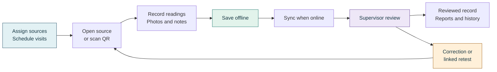
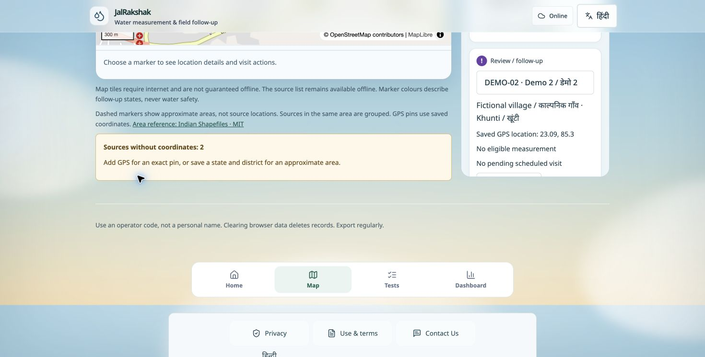

# 💧 JalRakshak

## A visit should not end in a forgotten notebook

A field worker reaches a village handpump. There is no mobile signal. The last reading is in a notebook, a photograph is on another phone, and the supervisor is still waiting to hear whether yesterday’s follow-up happened.

The worker can take another measurement. But who will connect it to the right source, compare it with earlier visits, and make sure someone returns when a reading needs attention?

**That missing connection is the problem JalRakshak sets out to solve.**

## From a field reading to a shared next step

With JalRakshak, the visit starts with an assigned source—or a scan of its QR label. The worker records independent EC readings, adds observations and photos, and saves the visit even without a connection. **IndexedDB keeps the saved work on the device.**

When the app is open and online again, saved records sync to a **shared SQLite backend**. A supervisor sees the evidence, requests a correction or linked retest, and follows the investigation through to a recorded outcome. The next worker starts with the source’s history, rather than a blank page.

Built for field teams across India, JalRakshak brings **offline work, role-based access, English/Hindi navigation and traceable follow-up** into one workflow.

<p align="center">
  
  
  
  
  <a href="LICENSE"></a>
</p>

<p align="center">
  <a href="#the-flow">The flow</a> ·
  <a href="#inside-the-app">UI snapshots</a> ·
  <a href="#tech-stack">Tech stack</a> ·
  <a href="#bonus-bring-the-instrument-into-the-workflow">Hardware bonus</a> ·
  <a href="#run-it-locally">Setup</a>
</p>

## One workspace, from assignment to evidence

<table>
<tr>
<td width="50%" valign="top">
<h3>📍 Know where to go</h3>
Sources across Indian states and districts, GPS pins, approximate area markers, QR labels and a searchable directory. Visit schedules surface today’s work, overdue visits and retests.
</td>
<td width="50%" valign="top">
<h3>📝 Capture the whole visit</h3>
Independent readings, repeatability checks, photos, notes and saved drafts. Work offline, then sync saved records when the connection returns.
</td>
</tr>
<tr>
<td valign="top">
<h3>👥 Keep the team connected</h3>
Worker and supervisor accounts, assigned sources, bulk import and assignment, recurring schedules, and clear review queues for submissions and corrections.
</td>
<td valign="top">
<h3>📈 Follow the evidence</h3>
Reading trends, quality flags, timestamped investigation history and linked retests. Export monthly reports and protect records with backup and restore tools.
</td>
</tr>
</table>

**Optional AI assistance:** turn a voice recording into reviewed notes, summarize source history, and prepare monthly report drafts from saved evidence. Ollama and faster-whisper run on your own machine or server. People review the output; AI does not change measurements or approve visits. [Explore the AI workflow →](docs/field/local-ai.md)

> [!NOTE]
> EC helps track changes and measurement consistency. It does not identify contaminants or establish drinking-water safety. Investigation and appropriate confirmatory testing remain essential.

## The flow



| Step | What happens |
| --- | --- |
| **1 · Plan** | The supervisor creates workers, imports or registers sources, and assigns visits. |
| **2 · Visit** | The worker selects the source, records independent readings, and adds evidence. |
| **3 · Save & sync** | The visit is saved locally, then synchronized while the app is open and online. |
| **4 · Review** | The supervisor reviews evidence and records a decision, correction request or retest. |
| **5 · Follow through** | Linked visits preserve the investigation history; reports show the team’s progress. |

Everyday navigation: **Home · Map · Tests · Dashboard**.

## Inside the app

### Find the source. See the next action.

The map combines source locations, follow-up markers, visit filters and a source directory.



### See the pattern behind the reading.

Measurement history connects compatible visits and distinguishes retests, disagreement readings and baseline exclusions.


*Both snapshots show the current field interface using isolated fictional practice records. The example locations are illustrative; no real team records are shown.*

**▶ [Watch the field walkthrough](docs/media/field-walkthrough.mp4)** — a short, silent tour of sources, measurements, history, investigations, reports and backups. The video uses synthetic records and an earlier UI layout. On GitHub, use **View raw** or download if playback is unavailable.

## Tech stack

| Layer | Built with | Why it is here |
| --- | --- | --- |
| **Application** | Next.js 16 App Router · React 19 · TypeScript | Shared frontend and backend with typed field workflows |
| **Interface** | Tailwind CSS 4 · custom CSS · Lucide | Responsive layouts, clear actions and consistent icons |
| **Backend** | Node.js · Next.js route handlers | Authentication, validation, synchronization and team operations |
| **Shared records** | SQLite via `node:sqlite` | Persistent accounts, assignments, synced evidence and audit events |
| **Offline device** | Dexie · IndexedDB · service worker | Account-scoped records, drafts and installable app support |
| **Access control** | Server sessions · scrypt password hashing | Workers access assigned sources; supervisors manage the team |
| **Maps & QR** | MapLibre GL · OpenStreetMap · qrcode · jsQR | Source discovery, map context and label scanning |
| **Instrument capture** | Web Serial · ESP32 serial protocol | Live USB readings with device and capture evidence |
| **Optional AI** | Ollama · faster-whisper · MediaRecorder | Private transcription and evidence-based draft assistance |
| **Deployment** | Docker Compose · Caddy · persistent volumes | Repeatable packaging, HTTPS routing and durable server data |
| **Quality** | Vitest · Playwright · GitHub Actions | Unit, browser and shared-server integration checks |

**Data path:** browser/IndexedDB ⇄ authenticated Node.js API ⇄ SQLite. Optional AI services sit behind the application; workers use the same JalRakshak interface.

## Bonus: bring the instrument into the workflow

Imagine taking a reading at the pump and seeing it appear directly beside the visit you are recording. **ESP32 USB integration connects instrument readings to their field context**, reducing retyping and preserving where each captured value came from.

Pair a compatible ESP32 with an EC probe and temperature sensor. Your sensor firmware supplies the measurements through the included [serial helper](firmware/esp32/JalRakshakSerial.h); JalRakshak receives the stream over USB.

| Instrument feature | Value in the field |
| --- | --- |
| **Live EC and temperature** | Watch readings as the probe settles before taking an independent sample. |
| **Device status and live chart** | See the connected instrument, recent readings and connection state together. |
| **Fresh-reading checks** | Stale, unstable or reused packets cannot be captured as a new independent reading. |
| **Capture into the visit** | Transfer each independent reading into its field, then review and save the visit. |
| **Traceable evidence** | Preserve device, session, sequence and receipt details with captured readings. |
| **Practice simulator** | Explore connection states and the live chart with clearly separated synthetic readings. |

**Connect:** open JalRakshak on localhost or HTTPS in desktop Chrome/Edge → connect the ESP32 with a data USB cable → choose **Connect ESP32 by USB** → select its serial port → capture independent readings → review and save.

The serial connection runs at **115200 baud** using newline-delimited `jalrakshak.ec.v1` packets. Manual entry remains available alongside the instrument workflow.

**[ESP32 firmware protocol and connection guide →](docs/field/esp32-usb.md)**

## Run it locally

### 1. Install and start

Use **Node.js 22.16 or newer**; Node 24 is recommended. You also need npm and Git.

```bash
git clone https://github.com/thisisanubhav/jalrakshak.git
cd jalrakshak
npm ci
npm run build
npm run start -- --hostname 127.0.0.1 --port 3000
```

Open **http://localhost:3000**. For development, use `npm run dev` instead of the build/start commands.

### 2. Create your team

1. On first access, read the generated setup key privately from `private-data/setup-key.txt`.
2. Enter it on the setup screen and create the first supervisor account with a password of at least 12 characters. There are no default accounts.
3. Open **Manage team** to create worker accounts.
4. Register or import sources, sync them, then assign workers and visit dates.
5. Sign in as a worker to record the first visit, save it and sync it back for review.

Use the same browser and address for daily work: `localhost` and `127.0.0.1` have separate browser storage. Existing device-only records are available at `/personal`.

### 3. Prepare for offline visits

Open the app and sign in online before leaving. Cached offline access lasts up to **12 hours**. Save visits explicitly; automatic sync needs the app open and online. Download a field backup after visits, and choose password encryption for a protected copy.

Device backups preserve saved sources, photos, measurements and follow-up history; they exclude accounts and unsaved drafts. Server backups contain synced team data:

```bash
npm run backup:team
```

Keep a backup on separate storage. [Full setup, sync and recovery guide →](docs/deployment/team-local.md)

<details>
<summary><strong>🐳 Optional: run a shared HTTPS server with Docker</strong></summary>

Use a server with Docker Engine, Compose v2, durable storage and a domain pointing to it. Ports 80/443 must reach Caddy for HTTPS certificate issuance.

```bash
cp deploy/.env.example deploy/.env
# Edit deploy/.env: set the domain, exact HTTPS origin and image tag.
docker compose --env-file deploy/.env config --quiet
docker compose --env-file deploy/.env build app
docker compose --env-file deploy/.env up -d --wait
```

Retrieve the initial setup key privately from the app container as described in the runbook. Workers then sign in through the same HTTPS address. SQLite data lives in a persistent volume; preserve that volume when updating containers.

[Docker setup and recovery](docs/deployment/docker.md) · [App + private AI containers](docs/deployment/docker-ai.md)

</details>

<details>
<summary><strong>✨ Optional: enable private voice and AI assistance</strong></summary>

Configure Ollama and faster-whisper, download their models, and set the server-only AI service URLs. On a configured local installation, `npm run ai:local` starts the services. Do not place service credentials in frontend variables.

Voice recording can be captured offline; transcription and drafting require a connection to the application server and its AI services. Review generated text before saving it to a visit or report.

[Local AI setup](docs/field/local-ai.md) · [Private Docker AI setup](docs/deployment/docker-ai.md)

</details>

**Current hosting:** this release is operated locally. Vercel Git deployments are disabled; the older public Vercel app does not represent this version. The Docker setup is available for a future shared host.

## Tested across the workflow

At application commit **`56660ba`**, the [post-merge GitHub Actions run](https://github.com/thisisanubhav/jalrakshak/actions/runs/40224557394) passed:

| Check | Result |
| --- | --- |
| Unit tests | **258 passed** |
| Chromium release tests | **70 passed · zero retries or skips** |
| Static checks | Lint, TypeScript and production build passed |
| Shared server | Docker HTTPS, sessions, permissions, durable records and backup restoration passed |
| Private AI | Text/speech inference, multiple workers, isolation, outages and restart recovery passed |

```bash
npm run lint
npm run typecheck
npm test
npm run build
```

Browser release tests run through [GitHub Actions](.github/workflows/ci.yml) with isolated test records. These checks verify the software workflow; EC comparison rules remain provisional and calibration details are operator-recorded metadata.

## Explore further

| Field operations | Running the system |
| --- | --- |
| [Daily field guide](docs/field/daily-work.md) | [Team server and recovery](docs/deployment/team-local.md) |
| [Visits, reviews and QR codes](docs/field/visit-operations.md) | [Docker deployment](docs/deployment/docker.md) |
| [Monthly reports](docs/field/monthly-reports.md) | [Private AI deployment](docs/deployment/docker-ai.md) |
| [ESP32 integration](docs/field/esp32-usb.md) | [Research and scientific scope](docs/research/) |

[AI-assistance disclosure](docs/submission/ai-use-disclosure.md) · [Historical release evidence](docs/archive/)

---

<p align="center"><strong>Keep the source, the evidence and the next visit connected.</strong><br/>JalRakshak · <a href="LICENSE">MIT licence</a> · © 2026 thisisanubhav</p>
