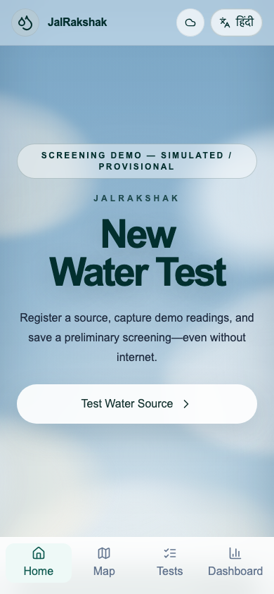
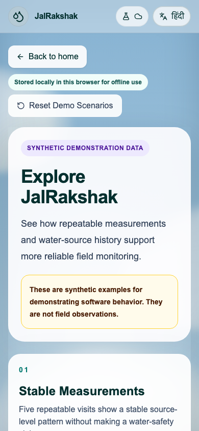
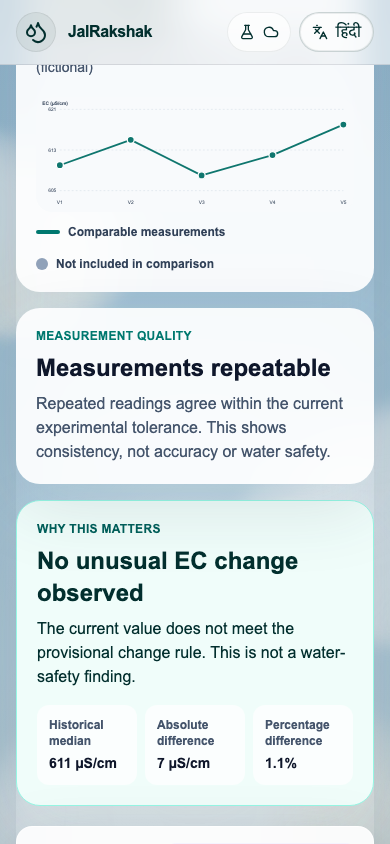
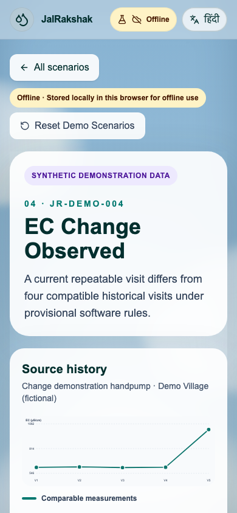
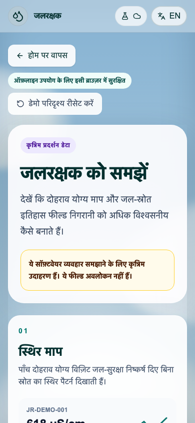
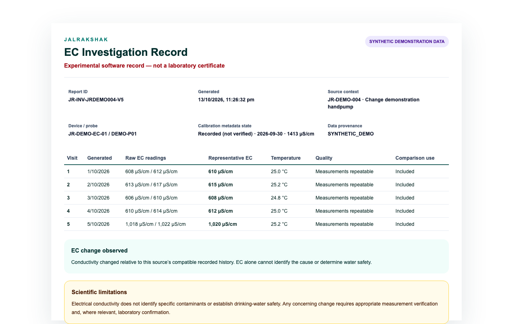
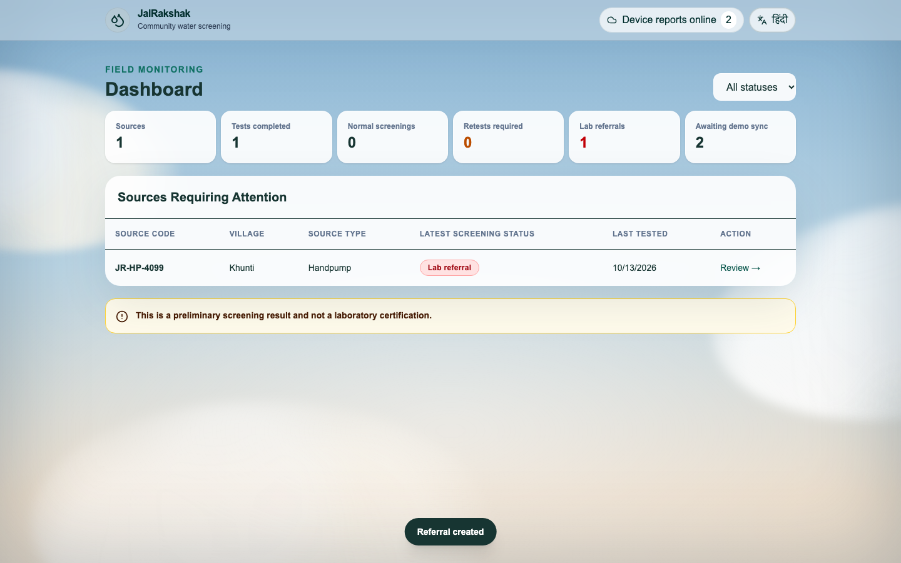
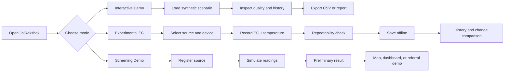
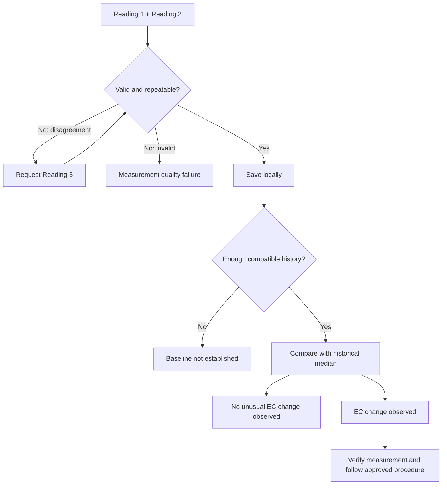

# JalRakshak

**Offline-first Water Measurement Quality and Field Decision-Support System for Rural Jharkhand.**

[Live application](https://jalrakshak-jharkhand.vercel.app) · [Demo script](docs/submission/final-demo-script.md) · [Research](docs/research/) · [MIT License](LICENSE)

JalRakshak is a bilingual, installable software prototype for recording water-source observations where connectivity is unreliable. It checks repeated EC readings, preserves source history locally, compares only compatible visits, and exports evidence for further investigation.

> **Scientific scope:** JalRakshak does not test water physically, identify contaminants, certify drinking-water safety, or replace Jhar-Jal, WQMIS, approved FTKs, or accredited laboratories. Current thresholds and judge scenarios are experimental or synthetic.

## Software-only field workflow

The default journey is **Water Sources → Record Measurement → Measurement History → Investigations → Reports**. Register and edit sources, enter independent readings manually, inspect repeatability and eligible historical changes, request and link retests, and preserve timestamped follow-up outcomes. No ESP32, connected sensor, cloud account or paid API is required.

Measurements and investigations remain on the current device. Missing calibration or temperature limits comparison without being labelled an invalid numeric reading. Rules are provisional and saved with each visit. EC cannot establish drinking-water safety.

English/Hindi source reports include the readings, calibration metadata, comparisons and investigation evidence. Export a source-scoped CSV or use browser **Print / Save as PDF**. Synthetic examples are isolated from manual field records.

This feature branch has **not been deployed**. The live link and older screenshots below may show the previous release. See the [audit](docs/audit/software-field-audit.md), [current verification and readiness](docs/submission/software-field-readiness.md), and [sourced submission, seven-slide outline and three-minute demo](docs/submission/software-field-submission.md).

## Product modes

| Mode | Purpose | Data origin |
| --- | --- | --- |
| **Field workflow (default)** | Manual measurements, quality, history, investigations, retests and reports | `MANUAL_FIELD` |
| **Software-only judge demo** | Four isolated field scenarios including a complete follow-up | `SYNTHETIC_DEMO` |
| **Interactive Demo** | Four deterministic scenarios explaining repeatability, disagreement, insufficient history, and EC change | `SYNTHETIC_DEMO` |
| **Experimental EC** | Manual EC and temperature capture, device/calibration metadata, repeatability, history, and export | `MANUAL_EXPERIMENT` |
| **Screening Demo** | Original simulated pH, TDS, turbidity, and temperature screening journey | `SIMULATED` |

The new field tables separate manual and synthetic scopes. Older Experimental EC and Screening Demo records remain intact and accessible through **Earlier experimental & screening demos**.

## Earlier-release UI

These screenshots document the earlier prototype, not the new field workspace.

<p align="center">
  
  
  
</p>

<p align="center">
  
  
</p>

<p align="center">
  
  
</p>

More production captures are available in [`docs/submission/screenshots`](docs/submission/screenshots/).

## Core flows



### Experimental EC decision flow



Repeatability means readings agree under the current provisional software rule; it does **not** prove accuracy or water safety. Incompatible visits remain visible but are excluded from the analytical trend.

## Tech stack

| Layer | Technology |
| --- | --- |
| Application | Next.js 16, React 19, TypeScript |
| Styling | Tailwind CSS 4, responsive light-theme design system |
| Offline storage | Dexie + IndexedDB |
| PWA | Web App Manifest + versioned service worker |
| Mapping | MapLibre GL + OpenStreetMap tiles with offline fallback |
| Domain logic | Typed screening, repeatability, provenance, and history modules |
| Localization | Centralized English and Hindi dictionaries |
| Export | Hardened CSV + browser Print / Save as PDF |
| Testing | Vitest + Playwright |
| Hosting | Vercel HTTPS deployment |

No production backend, authentication service, government API, or physical sensor is required for the public prototype.

## Key capabilities

- Source registration, geolocation, optional photo, map, history, dashboard, and referral demonstration
- Manual EC readings in `µS/cm` with temperature in `°C`
- Device/probe identity and calibration **metadata** without claiming verified calibration
- Duplicate-reading consistency checks and optional third reading
- Context-compatible historical comparison with explicit exclusion reasons
- Offline save, refresh recovery, and local-only data disclosure
- English/Hindi field journeys
- Synthetic judge scenarios isolated from user-entered records
- Safe CSV export and print-ready investigation report

## Run locally

Requirements: Node.js 20.9+ and npm.

```bash
git clone https://github.com/thisisanubhav/jalrakshak.git
cd jalrakshak
cp .env.example .env.local
npm install
npm run dev
```

Open <http://localhost:3000>. Environment variables are optional for the local software demo; never place secrets in `NEXT_PUBLIC_*` values.

## Verify

```bash
npm run lint
npm run typecheck
npm test
npm run test:e2e
npm run build
npm audit --audit-level=high
```

Original baseline: **61 unit tests**. The transformation adds domain, persistence, migration, evidence, export and offline-cache tests plus seven field browser scenarios. See the current readiness report for results; browser execution was blocked by the review environment and must pass before release.

If a restricted environment prevents Turbopack from binding its subprocess ports, use `npm run build -- --webpack`, then `npm run test:e2e:ci`. This does not change the production build configuration.

## Offline and privacy

- IndexedDB is the source of truth; records remain in the current browser profile.
- Clearing browser storage can permanently remove local records.
- Field and experimental records are not uploaded to a production database or government system.
- CSV is an evidence export, not a restorable backup. Browser storage clearing or eviction can lose records.
- Map tiles need connectivity unless already cached; locally stored source information remains available.
- Do not enter personal information, private pilot coordinates, or sensitive photographs in the public demo.

## Limitations

- Optional ESP32 USB serial input is implemented; physical hardware is not yet selected or validated. Bluetooth is not implemented. See [ESP32 USB setup](docs/field/esp32-usb.md).
- No contaminant detection or drinking-water safety classification
- No production cloud sync, authentication, or official government integration
- Experimental comparison rules are not regulatory or laboratory thresholds
- Calibration information is user-recorded metadata, not independent verification
- Direct institutional stakeholder validation remains pending

## Documentation

- [Scientific evidence and gap analysis](docs/research/)
- [Workflow validation](docs/validation/)
- [Field SOP and pilot plan](docs/field/)
- [Deployment and PWA runbook](docs/deployment/README.md)
- [Submission presentation](docs/submission/final-presentation.md)
- [Final readiness report](docs/submission/final-readiness.md)
- [AI-assistance disclosure](docs/submission/ai-use-disclosure.md)

## License

[MIT](LICENSE) © 2026 thisisanubhav

### Optional ESP32 input

Record Measurement supports live USB readings from compatible ESP32 firmware, with manual fallback. Captures preserve device evidence and require review before saving. This app-side integration is tested using emulated serial streams; sensor selection, firmware driver, calibration and physical acceptance remain pending. See [connection and firmware contract](docs/field/esp32-usb.md).
