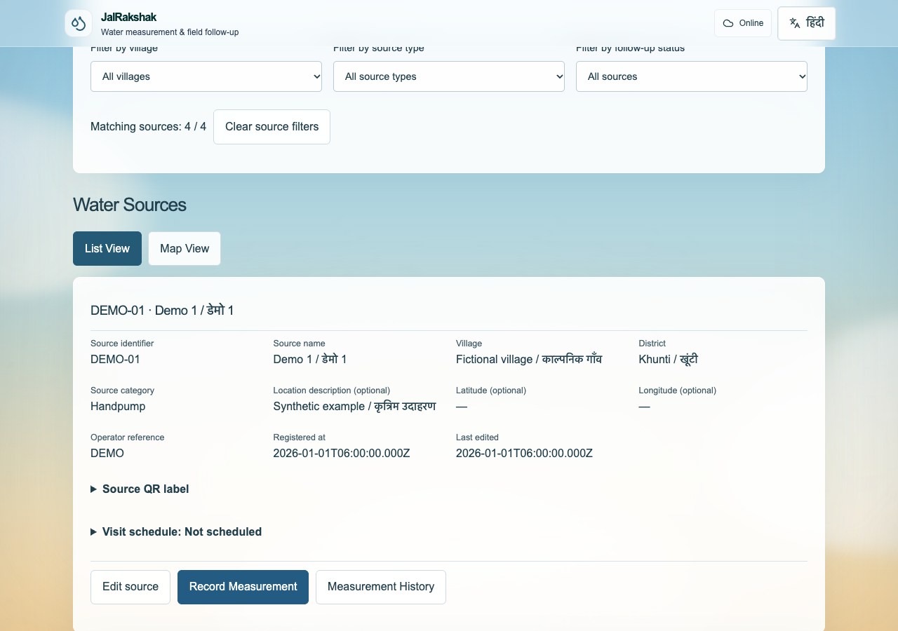
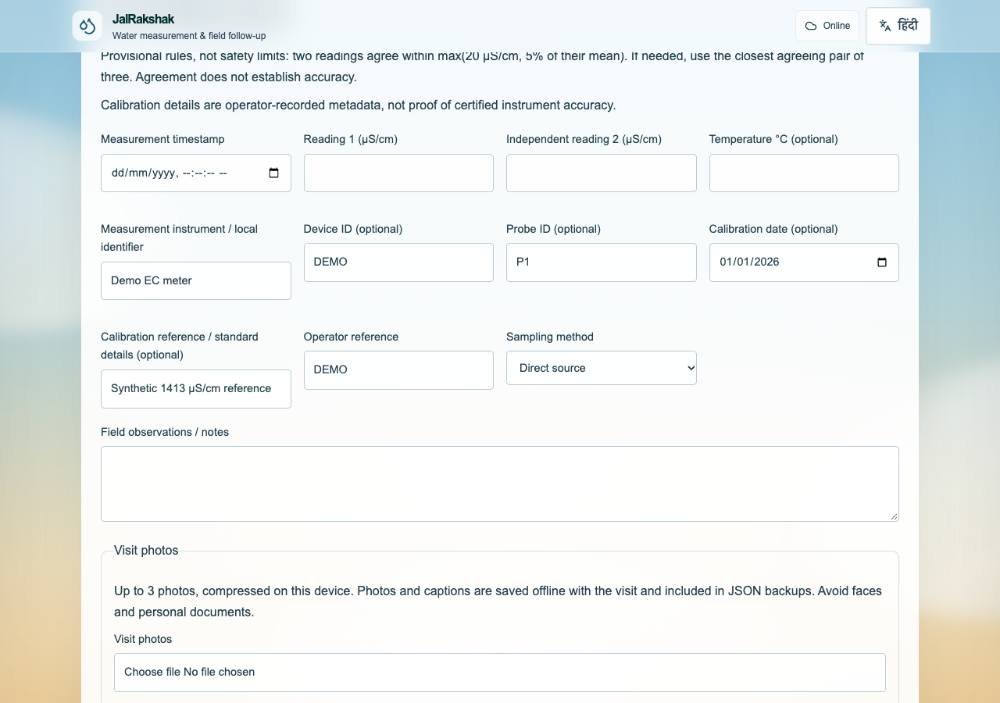
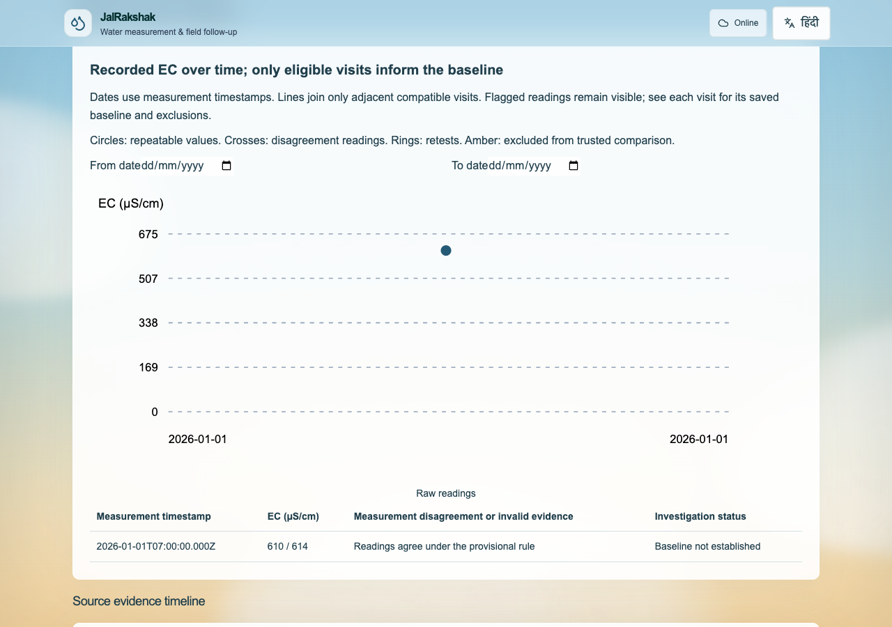
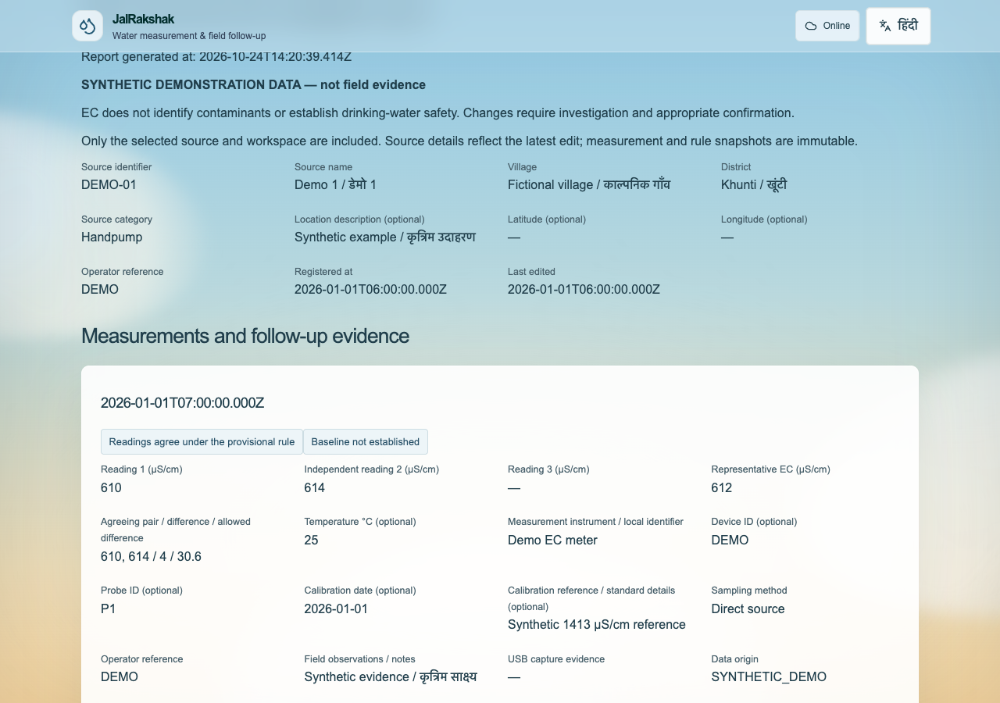

# JalRakshak

A field worker reaches a village hand pump. The mobile signal has disappeared. Yesterday’s readings are in a notebook, a photo is on another phone, and the supervisor still needs to know whether a follow-up visit happened.

Recording one reading is easy. Keeping the source, evidence, repeat measurements and next action together—across people and unreliable connections—is the harder problem.

**JalRakshak gives field workers and supervisors one place to manage water-source visits, save evidence offline and follow up when connectivity returns.** Built for rural field work in Jharkhand, it supports English and Hindi.

[Workflow](#the-flow) · [Screenshots](#see-the-app) · [Demo video](#demo-video) · [Run locally](#run-locally) · [Field guide](docs/field/daily-work.md)

> EC measurements help track measurement quality and changes over time. They cannot identify contaminants or certify drinking-water safety. JalRakshak does not replace approved field testing or laboratory analysis.

## The flow

**Assign → Visit → Record offline → Sync → Review → Follow up**

1. **Supervisor:** create worker accounts, register or import sources, assign ownership and schedule visits.
2. **Worker:** open an assigned source, or scan its QR label; record repeated EC readings, temperature, photos and notes.
3. **Save and sync:** keep records on the device offline; saved changes upload while the app is open and online. Review conflicting edits before applying them.
4. **Supervisor:** review submitted visits, request corrections or retests, and track outstanding work.
5. **Report and protect:** inspect history and trends, export monthly reports, and keep device and server backups.

Navigation stays simple: **Home · Map · Tests · Dashboard**.

## See the app

Current application captures using isolated, fictional training records. The login screen is the team entry point; the field screenshots demonstrate the shared field interface in its separate practice workspace.



| Record a visit | Inspect the evidence |
| --- | --- |
|  |  |



## Demo video

[](docs/media/field-walkthrough.mp4)

**[Watch or download the walkthrough (MP4)](docs/media/field-walkthrough.mp4)** — a short, silent screen walkthrough of sources, measurement entry, history, investigations, reports and backup tools. It uses synthetic training records, not real field data. If GitHub does not play it inline, use **View raw** or download the file.

## What it does

| For field workers | For supervisors |
| --- | --- |
| Assigned sources, search, maps and QR lookup | Worker accounts and bulk source assignments |
| Visit dates, overdue work and recurring schedules | CSV source import with validation and preview |
| Offline readings, photo evidence, notes and drafts | Submitted, correction-needed and reviewed visit queues |
| Repeatability checks, history and quality flags | Follow-up investigations and retest requests |
| English/Hindi interface and manual entry | Monthly reports, CSV exports and print/PDF reports |
| Optional ESP32 USB capture with manual fallback | Backup health, server backups and recovery tools |

## Tech stack

| Layer | Technology |
| --- | --- |
| Frontend | Next.js 16 App Router, React 19, TypeScript |
| UI | Tailwind CSS 4, custom responsive CSS, Lucide icons |
| Backend | Next.js API route handlers on Node.js |
| Shared database | SQLite through Node’s built-in `node:sqlite` |
| Authentication | Server sessions, scrypt password hashing, worker/supervisor authorization |
| Offline storage | Dexie + IndexedDB, account-scoped records and drafts |
| Installable app | Web App Manifest and versioned service worker |
| Maps and QR | MapLibre GL, OpenStreetMap tiles, qrcode and jsQR |
| Sensor interface | Optional Web Serial USB connection for ESP32 |
| Packaging | Docker Compose, Caddy HTTPS proxy, persistent SQLite volume |
| Verification | Vitest, Playwright Chromium and GitHub Actions |

Browser records support offline work; SQLite stores synchronized team records, accounts, assignments and audit events. Workers access their assigned sources; supervisors manage the full team.

## Run locally

Use **Node.js 22.16+** (Node 24 recommended) and npm.

```bash
git clone https://github.com/thisisanubhav/jalrakshak.git
cd jalrakshak
npm ci
npm run build -- --webpack
npm run start -- --hostname 127.0.0.1 --port 3000
```

Open **http://localhost:3000**. On first access, read the generated setup key privately from `private-data/setup-key.txt`, then create the initial supervisor account with a password of at least 12 characters. There are no default accounts. Create workers under **Manage team**.

For development, use `npm run dev`. Existing device-only records remain accessible at `/personal`.

**Deployment status:** the current release runs locally. Vercel Git deployments are disabled; the older public Vercel app does not represent this release. Connecting workers on different devices requires one shared HTTPS server with durable storage. Online hosting is deferred.

Docker packaging is available: follow the [Docker runbook](docs/deployment/docker.md) for configuration, startup, persistent volumes and recovery. It does not provision a host or migrate local data automatically.

## Offline work and backups

- Sign in online before leaving for the field. Cached offline access lasts up to 12 hours; use the same trusted browser and address.
- Automatic sync requires the app open and online. Unsynced changes exist only on that device; remote account restrictions take effect on reconnection.
- Download a field JSON backup to preserve saved sources, photos, measurements and follow-up history. It excludes accounts and unsaved drafts.
- Run `npm run backup:team` for a consistent server SQLite backup. Server backups include synced data; keep a copy on separate storage.
- Browser data and JSON backups are not encrypted. Clearing browser storage can remove unsynced work. Map tiles require connectivity unless cached.

See [setup, synchronization and recovery](docs/deployment/team-local.md) for the full operating procedure.

## Verification

The [post-merge CI run](https://github.com/thisisanubhav/jalrakshak/actions/runs/40101136127) on **24 October 2026** passed:

- **213 unit tests** and **55 Chromium release tests**, with zero browser retries or skips.
- Lint, TypeScript checks and production build.
- Docker HTTPS, session permissions, data persistence and backup recovery checks.

```bash
npm run lint
npm run typecheck
npm test
npm run build -- --webpack
```

The release browser suite runs through [GitHub Actions](.github/workflows/ci.yml), with Chromium sandboxing enabled and isolated test records.

## Current boundaries

Physical ESP32 hardware, sensor drivers and calibration still need acceptance testing; Bluetooth is not implemented. Software checks use emulated sensor input and map fixtures. Real field-worker pilot validation remains pending.

EC comparison rules are provisional, and calibration details are user-recorded metadata. There is no government-system integration or drinking-water safety certification.

## Further reading

- [Daily field workflow](docs/field/daily-work.md)
- [Visits, evidence, reviews and QR codes](docs/field/visit-operations.md)
- [Monthly reports](docs/field/monthly-reports.md)
- [ESP32 USB protocol and setup](docs/field/esp32-usb.md)
- [Local team server and recovery](docs/deployment/team-local.md)
- [Docker deployment](docs/deployment/docker.md)
- [Research and scientific scope](docs/research/)
- [AI-assistance disclosure](docs/submission/ai-use-disclosure.md)

## License

[MIT](LICENSE) © 2026 thisisanubhav
