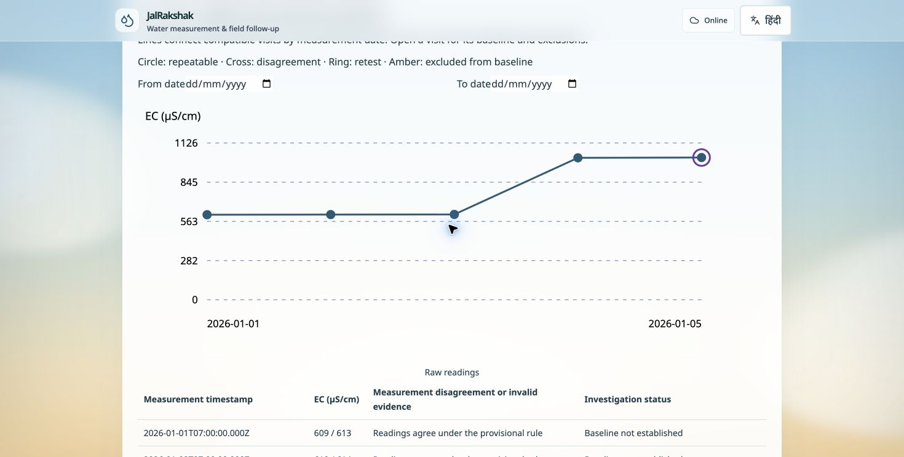

<h1 align="center">JalRakshak</h1>
<p align="center"><strong>AI powered water fieldwork from offline visits to evidence led follow up.</strong></p>
<p align="center">Capture in the field. Understand with AI. Review as a team.</p>

<p align="center">
  <a href="https://jalrakshak-jharkhand.vercel.app/"></a>
  <a href="https://jalrakshak-jharkhand.vercel.app/signup"></a>
</p>

<p align="center">
  
  
  
  
  <a href="LICENSE"></a>
</p>

<p align="center">
  <a href="#how-it-works">Workflow</a> ·
  <a href="#ai-assistance">AI assistance</a> ·
  <a href="#inside-the-app">UI snapshots</a> ·
  <a href="#tech-stack">Tech stack</a> ·
  <a href="#esp32-integration">Hardware</a> ·
  <a href="#run-it-locally">Setup</a>
</p>

---

## A field visit deserves a follow-up

A worker reaches a handpump with no signal. Readings are in a notebook, photos on another phone, and the supervisor is waiting. **The evidence exists, but the follow-up gets lost.**

**JalRakshak connects that visit to the next action.** Save readings, photos and notes offline in **IndexedDB**; sync to **PostgreSQL on Neon** for team review. AI helps turn recorded evidence into useful drafts, while people make the decisions.

<table>
<tr>
<td width="50%" valign="top"><h3>For field workers</h3>Find assigned sources, capture visits offline and return with complete evidence.</td>
<td width="50%" valign="top"><h3>For supervisors</h3>Coordinate teams, review submissions and track corrections or linked retests.</td>
</tr>
</table>

## Start your team

**Sign up with Google or verify your email → create an organisation → invite workers.** Each organisation has its own records. Supervisors assign sources and review visits; workers manage their assigned fieldwork. [Account guide →](docs/organisation-signup.md)

## How it works

<table>
<tr>
<td width="33%" valign="top"><h3>📍 Find</h3>Assigned sources, map pins, QR labels and scheduled visits.</td>
<td width="34%" valign="top"><h3>📝 Record</h3>Readings, photos and notes. Save offline; sync when online.</td>
<td width="33%" valign="top"><h3>🔎 Follow up</h3>Supervisor review, linked retests, trends and reports.</td>
</tr>
</table>

**Daily tools:** recurring schedules, bulk import and assignment, review queues, monthly reports, and password-protected field backups.

> EC tracks changes; it does not identify contaminants or establish drinking-water safety.

---

## AI assistance

**Less typing in the field. Less time preparing reports.**

<table>
<tr>
<td width="33%" valign="top"><h3>🎙 Voice → notes</h3>Transcribe English/Hindi recordings and prepare visit-note drafts.</td>
<td width="34%" valign="top"><h3>📖 History → summary</h3>Bring saved readings, reviews and retests into a source summary.</td>
<td width="33%" valign="top"><h3>📊 Evidence → report</h3>Prepare a monthly narrative from saved team evidence.</td>
</tr>
</table>

**Powered by Groq on the hosted app**, with **Ollama + faster-whisper** available for self-hosting. AI needs a connection; manual fieldwork stays available offline.

> [!NOTE]
> **You stay in control.** AI runs only on request. Audio or selected text goes to the configured provider. Review drafts before saving; AI does not change measurements or approve visits.

[Hosted AI setup →](docs/deployment/hosted-ai.md) · [Local AI setup →](docs/field/local-ai.md)

---

## Inside the app

<table>
<tr>
<td width="50%"><a href="docs/media/field-map.jpg"></a></td>
<td width="50%"><a href="docs/media/field-history.jpg"></a></td>
</tr>
<tr>
<td align="center"><strong>Explore your field area</strong><br/><sub>Source locations · visit filters · follow-up status</sub></td>
<td align="center"><strong>See the evidence over time</strong><br/><sub>Reading trends · linked retests · quality flags</sub></td>
</tr>
</table>

<sub>Click a snapshot to view full size. Fictional practice records and illustrative locations.</sub>

## Tech stack

<p align="center">
  
  
  
  
  
</p>

| Layer | Technologies |
| --- | --- |
| Frontend | Next.js 16 · React 19 · TypeScript |
| UI | Tailwind CSS 4 · Lucide |
| Backend & database | Node.js · Next.js route handlers · PostgreSQL (hosted) · SQLite (local) |
| Offline | Dexie · IndexedDB · service worker |
| Authentication | Google OpenID Connect · email verification · server sessions · scrypt |
| Maps & QR | MapLibre GL · OpenStreetMap · qrcode · jsQR |
| Hardware | Web Serial · ESP32 |
| AI | Groq · Ollama · faster-whisper · MediaRecorder |
| Deployment | Vercel · Neon · Docker Compose · Caddy |
| Testing | Vitest · Playwright · GitHub Actions |

## ESP32 integration

**From probe to visit without retyping.** Connect a compatible ESP32 and EC probe over USB; capture readings with device evidence, then review and save.

| Live view | Reliable capture | Practice mode |
| :---: | :---: | :---: |
| EC · temperature · chart | Fresh-reading checks · device details | Isolated simulator |

[Connect your hardware →](docs/field/esp32-usb.md)

## Repository guide

| Checklist | Files |
| --- | --- |
| Setup & environment variables | [Quick start](#run-it-locally) · [Environment reference](docs/deployment/environment.md) · [.env.example](.env.example) |
| Technical design & diagrams | [Architecture, data model and sync flow](docs/technical-design.md) |
| Sample data & test cases | [Testing guide](docs/testing.md) · [Fictional source CSV](docs/samples/sources.csv) |
| Licence | [MIT](LICENSE) |

## Run it locally

> **Quick start** · Node.js 22.16+ · npm · Git

```bash
git clone https://github.com/thisisanubhav/jalrakshak.git
cd jalrakshak
npm ci
cp .env.example .env.local
npm run build
npm run start -- --hostname 127.0.0.1 --port 3000
```

The example needs no external-service credentials for local use. Configure optional services using the [environment reference](docs/deployment/environment.md).

Local installs use **SQLite** by default. Open **http://localhost:3000** and use the private key in `private-data/setup-key.txt` to create your supervisor account (password: 12+ characters), then add workers through **Manage team**. For development, use `npm run dev`.

Sign in online before fieldwork, use the same browser/address, and save visits before syncing. Keep backups on separate storage. [Setup & recovery →](docs/deployment/team-local.md)

**Deployment guides:** [Vercel + Neon](docs/deployment/vercel.md) · [Docker server](docs/deployment/docker.md) · [Local AI](docs/field/local-ai.md) · [Docker with AI](docs/deployment/docker-ai.md)

## Credits

<p align="center">
  <a href="https://www.linkedin.com/in/anubhav-sinha-a70019287/"><strong>Anubhav Sinha</strong></a><br/>
  Swastika Rani
</p>

## AI disclosure

AI tools assisted with code, tests, documentation and interface copy. The project owner directed scope and release decisions. [Read the full disclosure →](docs/submission/ai-use-disclosure.md)

<p align="center">
  <a href="docs/field/daily-work.md"><strong>Field guide</strong></a> &nbsp; · &nbsp;
  <a href="docs/field/visit-operations.md"><strong>Visits & reviews</strong></a> &nbsp; · &nbsp;
  <a href="docs/field/monthly-reports.md"><strong>Monthly reports</strong></a>
</p>

---

<p align="center">JalRakshak · <a href="LICENSE">MIT licence</a> · © 2026 thisisanubhav</p>
