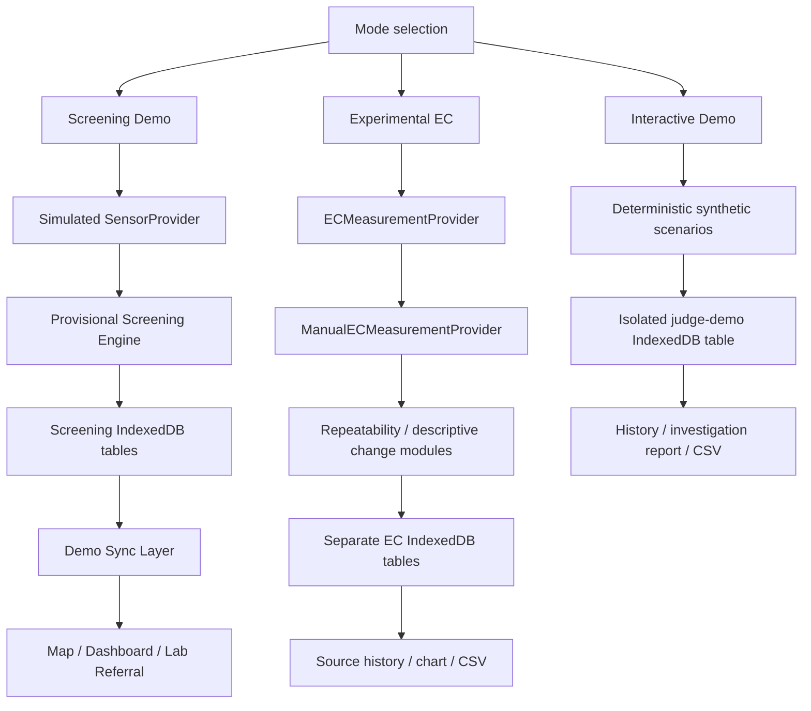

# JalRakshak

Offline-first community water-quality screening and early-warning software for Jharkhand, India. JalRakshak helps a field worker register a water source, simulate a multi-parameter sensor reading, apply transparent screening rules, save the visit without connectivity, and escalate an observation for accredited laboratory confirmation.

> **Scientific disclaimer:** JalRakshak provides preliminary screening only. It is not a laboratory certification and does not determine whether water is safe or unsafe to drink. The thresholds in this software MVP are provisional demonstration values and require validation by qualified experts against the applicable BIS/JJM protocols before any field deployment.

Public software-only demo: **<https://jalrakshak-jharkhand.vercel.app>**. It requires no account, credentials, backend, or physical hardware.

Final submission resources: [presentation content](docs/submission/final-presentation.md), [three-minute demo script](docs/submission/final-demo-script.md), [release readiness](docs/submission/final-readiness.md), and [AI-assistance disclosure](docs/submission/ai-use-disclosure.md).

JalRakshak has three explicitly separate software experiences:

- **Screening Demo** preserves the original simulated four-parameter MVP and provisional statuses.
- **Experimental EC** records manually entered raw electrical conductivity and temperature, checks repeatability, retains visits offline, and visualizes same-source history. It is a research workflow—not a sensor integration or water-safety detector.
- **Interactive Demo** uses four isolated, deterministic `SYNTHETIC_DEMO` scenarios so judges can understand repeatability, disagreement, insufficient history, and descriptive EC change without creating field records.

## Problem being solved

Community monitoring is often performed where connectivity is unreliable and specialist equipment is scarce. JalRakshak turns a field observation into a traceable digital record while carefully separating **screening signals** from confirmed laboratory findings.

## What is implemented

- Mobile-first field home with online/offline and pending-sync state
- Source registration, source codes, manual coordinates, browser geolocation, and optional photo
- Hardware-independent `SensorProvider`, explicit data-origin metadata, and animated deterministic presets
- Isolated, typed screening engine returning `NORMAL_SCREENING`, `RETEST`, or `LAB_REFERRAL`
- IndexedDB storage for sources, tests, readings, referrals, and sync state
- Idempotent sync queue transitions: `LOCAL_ONLY → SYNCING → SYNCED` or `SYNC_FAILED`
- Jharkhand-focused MapLibre map and explicit screening-status legend
- Test history, monitoring dashboard, status filtering, and lab-referral creation
- Centralized English/Hindi translations for the core field journey
- Installable PWA shell with versioned same-origin caching and an offline map fallback
- Production security headers, a non-destructive service-worker update prompt, and bilingual local-data/privacy disclosure
- Demo reset and a judge-friendly referral path that takes under 90 seconds
- Separate Experimental EC workflow with manual-provider provenance, device/calibration metadata, repeatability review, optional third reading, same-source history, an accessible offline chart, transparent provisional change comparison, and CSV export
- A bilingual, offline-capable judge walkthrough with isolated synthetic snapshots, safe CSV export, and a print-ready investigation record that can be saved as PDF

## What is demo / simulated

- Every reading in **Screening Demo**—pH, TDS, turbidity, and temperature—is generated by `SimulatedSensorProvider`; the UI labels it **SIMULATED — SYNTHETIC DEMONSTRATION DATA**. Experimental EC records are separate, manually entered research data.
- The first proposed hardware prototype will focus on TDS/conductivity and temperature. pH and turbidity remain software-demonstration values until appropriate hardware, calibration, and validation exist.
- Screening rules are deterministic **DEMO / PROVISIONAL** rules. They are screening logic, not regulatory or laboratory standards.
- “Sync” uses a local acknowledgement adapter. It demonstrates queue states and idempotency but does not upload to a production cloud service.
- Map markers represent preliminary screening statuses. They are not official contamination records.

## Experimental EC Mode

Round 3 evidence review recommended testing a narrower concept: whether repeatable source-level electrical-conductivity history can support measurement verification and approved follow-up without being mistaken for contaminant detection. Round 4 prepared that validation, but **direct stakeholder validation remains pending**.

Experimental EC Mode exists to test the software workflow before any hardware work:

1. select or register a durable source;
2. select or record an experimental device and probe;
3. explicitly choose **Calibration recorded** or **Calibration not recorded**; supplied metadata is validated without claiming that the software performed or verified calibration;
4. manually enter temperature and two raw EC readings in `µS/cm`;
5. apply an explicitly provisional repeatability rule and request a third reading when needed;
6. save the visit locally with `MANUAL_EXPERIMENT` provenance;
7. compare only repeatable, calibrated manual visits from the same source, device/probe, sampling method, and provisional temperature envelope; and
8. export the experimental record as CSV.

EC reflects the water’s ability to conduct electricity and can change with dissolved ionic content or measurement/context conditions. EC alone cannot identify arsenic, fluoride, iron, lead, nitrate, pathogens, pesticides, or another specific contaminant. It cannot determine whether water is safe. Temperature is stored as measurement context; the app does not invent a compensation formula or calculate compensated EC at 25°C.

The software-only repeatability assumption is the greater of `20 µS/cm` or `5%`. The history demonstration requires three prior repeatable manual visits and flags a descriptive change only when both `100 µS/cm` and `25%` difference from the historical median are reached. These values are isolated configuration for software evaluation—not validated scientific, safety, regulatory, or operational thresholds. Tests inject their own rules rather than asserting that the defaults are scientific truth.

Experimental EC records use separate IndexedDB tables and never enter the Screening Demo dashboard, status counts, map, or laboratory-referral logic. Resetting Experimental EC clears only its devices, visits, and exclusively experimental source records. Hardware is not connected; an ESP32 provider contract is reserved but has no implementation.

The EC history chart uses the same eligibility function as the comparison engine. Comparable visits appear as teal points and may form continuous teal segments. Incompatible or invalid visits remain inspectable as neutral markers with a plain-language exclusion reason; the chart never connects across an excluded visit. Corrupt persisted values are rendered as unavailable and cannot enter a baseline or change result.

Evidence and validation boundaries:

- [Longitudinal EC evidence review](docs/validation/ec-longitudinal-evidence.md)
- [Provisional measurement protocol](docs/validation/ec-measurement-protocol.md)
- [Precommitted decision criteria](docs/validation/decision-criteria.md)
- [Hypothesis scorecard](docs/validation/hypothesis-scorecard.md)
- [Proposed minimum EC product](docs/validation/proposed-ec-mvp.md)

## What is planned, not implemented

ESP32/Bluetooth capture, authenticated Supabase synchronization, validated field protocols, offline map packs, and accredited laboratory-result management are intentionally outside this MVP.

## Scientific scope

Round 3 evidence review recommends a **PIVOT** before hardware work. TDS/conductivity plus temperature cannot certify safety or identify arsenic, fluoride, iron, lead, nitrate, pathogens, pesticides or other specific contaminants. Temperature is primarily measurement/compensation context. A future physical prototype is justified only as a validated experiment in repeatable, source-specific conductivity change detection, followed by the existing approved FTK and laboratory workflow.

Jharkhand already has Jal Sahiyas, Field Test Kits, Jhar-Jal and the national WQMIS/laboratory pathway. JalRakshak should complement those systems as an offline measurement-quality and longitudinal-history tool, not create a parallel contamination registry or referral authority. The current four-parameter readings and screening thresholds remain simulation-only and must not be applied to real sensor data.

Research and proposed field controls:

- [Jharkhand evidence review](docs/research/jharkhand-water-problem.md)
- [Existing JJM/Jharkhand workflow](docs/research/existing-water-quality-system.md)
- [Scientific basis and rule audit](docs/research/scientific-basis.md)
- [Detection capability matrix](docs/research/detection-capability-matrix.md)
- [Gap thesis and kill analysis](docs/research/jalrakshak-gap-thesis.md)
- [Draft field SOP](docs/field/field-screening-sop.md) and [smallest credible pilot](docs/field/pilot-plan.md)
- [Source register](docs/research/sources.md)

## Architecture



The UI only knows the `SensorProvider` contract. `SimulatedSensorProvider` is active now. The measurement envelope supports partial readings plus per-measurement availability, origin, and provider metadata. The reserved `BluetoothSensorProvider` therefore declares TDS/conductivity and temperature as available while pH and turbidity are `NOT_CONNECTED`; future hardware must never invent values for missing capabilities. A screening result is created only when all readings required by the current provisional rule set are present and valid. Stored tests keep their source ID and timestamp, so repeated screenings already form a history suitable for a future current-reading-versus-baseline feature. Screening thresholds live in one explicitly provisional configuration file. Persistence and sync are similarly separated from the UI.

### Important modules

| Area                             | Location                           |
| -------------------------------- | ---------------------------------- |
| Domain models                    | `src/domain/types.ts`              |
| Provisional rule configuration   | `src/domain/screening-config.ts`   |
| Screening engine                 | `src/domain/screening.ts`          |
| Sensor abstraction and simulator | `src/sensors/provider.ts`          |
| IndexedDB repository             | `src/data/database.ts`             |
| Sync transport/state machine     | `src/data/sync.ts`                 |
| Localization                     | `src/i18n/translations.ts`         |
| Field experience                 | `src/components/JalRakshakApp.tsx` |
| MapLibre view                    | `src/components/MapPanel.tsx`      |
| Future PostgreSQL schema         | `docs/supabase-schema.sql`         |
| Experimental EC domain/config    | `src/ec/`                          |
| Experimental EC field experience | `src/components/ExperimentalECMode.tsx` |
| Experimental EC localization     | `src/i18n/ec-translations.ts`      |
| Interactive judge scenarios      | `src/demo/`                        |
| Judge demo experience            | `src/components/InteractiveJudgeDemo.tsx` |
| Submission evidence              | `docs/submission/`                 |

## Local setup

Requirements: Node.js 20.9+ and npm.

```bash
cp .env.example .env.local
npm install
npm run dev
```

Open [http://localhost:3000](http://localhost:3000).

### Environment variables

| Variable                    | Required | Purpose                                         |
| --------------------------- | -------: | ----------------------------------------------- |
| `NEXT_PUBLIC_SYNC_ENDPOINT` |       No | Reserved endpoint for the cloud sync transport  |
| `NEXT_PUBLIC_DEMO_MODE`     |       No | Makes the removable simulator selector explicit |

No secrets belong in `NEXT_PUBLIC_*` variables. `.env`, credentials, pilot coordinates, and private field data are gitignored.

## Demo instructions

### Interactive judge demo (recommended)

1. Open the [public PWA](https://jalrakshak-jharkhand.vercel.app) and choose **Explore Interactive Demo**.
2. Load **Stable Measurements** to see repeatability and a compatible five-visit history.
3. Load **Measurement Disagreement** to see why a third reading is required before interpretation.
4. Load **Insufficient History** to confirm that one visit cannot establish a baseline.
5. Load **EC Change Observed** to inspect the historical median, absolute/percentage difference, and provisional assumptions.
6. Generate the investigation record, then use browser **Print / Save as PDF** or export the scenario CSV.

Every scenario is deterministic, fictional, and marked **SYNTHETIC DEMONSTRATION DATA**. Scenario snapshots use a dedicated IndexedDB table, remain available offline after initial caching, and can be reset without deleting Screening Demo or Experimental EC records. The [final three-minute script](docs/submission/final-demo-script.md) provides the recommended walkthrough.

### Screening Demo

1. Click **Test Water Source**.
2. Keep or edit the prefilled handpump details and use browser location if desired.
3. Continue and select **Lab-referral preset** in the visibly marked Demo Mode control.
4. Start screening and watch the four readings arrive.
5. Review the reason codes and scientific disclaimer, then **Save Test**.
6. Create the lab referral and open the map.
7. Use **Dashboard** to inspect the attention queue and **Tests** to view the referral ID.
8. Toggle **हिंदी** at any point in the field flow.

Use **Reset demo data** on Home before a fresh judge walkthrough.

### Experimental EC

1. From Home, open **Experimental EC**.
2. Start a measurement and select an existing source or register a new one.
3. Select or create an experimental device. Leave calibration date empty to exercise the visible “Calibration not recorded” state.
4. Enter temperature plus two raw EC readings. Use substantially different readings to trigger Reading 3.
5. Review repeatability, then save locally.
6. The first valid visit reports **Baseline not established** rather than implying no anomaly.
7. Add visits and open **Source history** to view the accessible chart and descriptive comparison.
8. Export CSV or clear only Experimental EC data.

## Offline behavior

IndexedDB is the source of truth for the MVP. Source registration, measurement, saving, mapping, history, dashboard review, and referral creation continue without a network. Each write receives a UUID and `LOCAL_ONLY`; the sync transport sends only non-synced IDs, marks them `SYNCING`, and atomically applies acknowledgements. A failure changes them to `SYNC_FAILED`, allowing a later retry without generating duplicate IDs.

Experimental EC also uses IndexedDB as its source of truth, but deliberately does not use the Screening Demo sync adapter. Manual visits remain local and usable through refresh/reconnect; CSV is the experiment’s explicit extraction path. This prevents a simulated acknowledgement from being confused with an institutional or production upload.

`DemoSyncTransport` acknowledges records locally so the complete demo has no credential dependency. A visible note prevents this from being mistaken for cloud upload. `docs/supabase-schema.sql` documents a compatible PostgreSQL target. Production work should add authentication, row-level security policies, and a server-side bulk-upsert endpoint before selecting a Supabase transport.

Map tiles require connectivity unless already present in the browser cache. Source records and their list/dashboard representations remain available offline.

Public-demo records remain inside the current browser profile. Clearing site data can delete them, and they are not automatically shared with government systems or backed up to a production cloud. Do not enter personal information or private pilot data; source coordinates and photographs can be sensitive. See the [deployment and PWA runbook](docs/deployment/README.md).

## Verification

```bash
npm run lint
npm run typecheck
npm test
npm run test:e2e
npm run build
```

`npm run test:e2e` builds the production application and runs Playwright in isolated Chromium contexts. The committed browser suite covers the Screening Demo referral path and map failure fallback, Experimental EC repeatability and third-reading handling, calibration states, history/change comparison, incompatible visits, CSV export safety, offline save/refresh/reconnect, Hindi state preservation, responsive overflow, corrected light-theme contrast, geolocation denial, unavailable storage, PWA metadata, service-worker activation, and production security headers. Install the local browser binary once with `npx playwright install chromium` if Playwright requests it. Run the same suite against a deployed build with `PLAYWRIGHT_BASE_URL=https://example.vercel.app npm run test:e2e:ci`.

Pull requests run the same lint, typecheck, unit-test, production-build, and Chromium E2E gates in `.github/workflows/ci.yml` without external accounts or secrets.

Unit coverage includes rule boundaries and invalid values, all deterministic simulator presets and provenance, source-code formatting, IndexedDB persistence, duplicate-save/referral protection, reset behavior, and sync concurrency/partial acknowledgements.

Experimental EC coverage includes provider provenance, invalid inputs, repeatability and third-reading handling, outlier exclusion, missing calibration metadata, insufficient history, injected change rules, data separation/reset behavior, corrupt-record fail-closed behavior, offline IndexedDB persistence, and CSV export.

## Screenshots

Fresh Round 2 browser-QA captures are stored in `docs/screenshots/`, including:

- `home-mobile.png`, `register-source-mobile.png`, and `screening-progress-mobile.png`
- `normal-result-mobile.png`, `retest-result-mobile.png`, and `referral-result-mobile.png`
- `map-mobile.png`, `offline-map-mobile.png`, and `source-history-mobile.png`
- `lab-referral-mobile.png`, `hindi-result-mobile.png`, and `dashboard-desktop.png`
- `map-desktop.png` for a clean production-mode desktop map capture

The current Round 6 production-build evidence is stored in `docs/screenshots/round-6/`. Mobile captures are exactly `390 × 844`; desktop captures are exactly `1440 × 900`. They include:

- `home-mobile.png`, `home-desktop.png`, and `screening-demo-mobile.png`
- `experimental-ec-home-mobile.png`, `device-registration-mobile.png`, and `ec-measurement-mobile.png`
- `repeatability-result-mobile.png`, `measurement-disagreement-mobile.png`, and `third-reading-mobile.png`
- `ec-change-comparison-mobile.png`, `ec-history-mobile.png`, and `incomparable-history-mobile.png`
- `offline-ec-state-mobile.png`, `hindi-ec-result-mobile.png`, and `dashboard-desktop.png`

Round 8 judge-demo evidence is stored in `docs/screenshots/round-8/`. It includes the desktop/mobile landing, all four scenarios, source history, print-ready investigation record, Hindi journey, and offline-restored demo. Mobile captures are exactly `390 × 844`; the desktop landing is `1440 × 900`. Regenerate them from a production server with `npm run screenshots:round8`.

Final Round 9 production evidence is stored in `docs/submission/screenshots/`. It was captured directly from the public HTTPS deployment and includes Home, Interactive Demo, all four scenarios, EC history, the print-ready investigation record, offline state, Hindi UI, and the desktop dashboard. Regenerate it with `npm run screenshots:submission`; override the target only when needed with `EVIDENCE_BASE_URL`.

Regenerate these from a production server with `npm run screenshots:round6`; the capture script fails if it observes a browser page or console error.

## Current limitations

- No real ESP32/Bluetooth transport in this iteration
- No authenticated multi-device backend; cloud sync is a local demo adapter
- PWA caching is deliberately minimal, and map tiles are not packaged for offline use
- Photo capture is stored locally as a small data URL and is not uploaded
- No accredited laboratory result entry/editing yet; the referral lifecycle model is ready for it
- Hindi covers the main field journey and guidance; scientific symbols, units, source codes, and stored reason codes remain unchanged intentionally
- Provisional thresholds must not be used operationally before scientific and governance review
- Experimental EC values are manual entries, not readings captured from a physical device
- Direct institutional stakeholder validation is still pending
- Experimental repeatability and change rules exist only to test software behavior and must be replaced or removed after bench and user validation
- EC calibration metadata remains mutable device metadata rather than an immutable, independently verified calibration event; field use requires a dedicated traceability model
- Investigation reports are browser-generated print views with **Save as PDF** support; they are explicitly experimental records and not official certificates
- Multi-tab writes and cross-device source-code collision handling remain limited; this software-only prototype is single-operator and local-first
- Public-demo data has no remote backup; clearing browser/site storage can permanently remove local records

## Roadmap

1. Validate rules, units, calibration, and field SOPs with water-quality specialists.
2. Implement an authenticated Supabase bulk-upsert transport with row-level security.
3. Build the ESP32 BLE provider and calibration/connection health workflow.
4. Add encrypted offline map packs and conflict-aware multi-device sync.
5. Add accredited lab result entry, chain of custody, audit history, and export.
6. Expand translations with a Jharkhand-relevant language after field research.

## Replacing the simulator with ESP32

Implement `SensorProvider.measure(onProgress)` in `BluetoothSensorProvider`, returning only connected readings and a provenance entry for every measurement. The planned first capability map is TDS/conductivity and temperature available from `SENSOR`, with pH and turbidity explicitly `NOT_CONNECTED`. Validate packet checksums, units, calibration metadata, device identity, and timeout behavior inside the provider. The screening engine fails closed when required measurements are absent, so missing channels cannot silently become normal results or simulated hardware values. `LAB_CONFIRMED` is reserved for a future accredited-laboratory workflow and must never be assigned by a field sensor.
