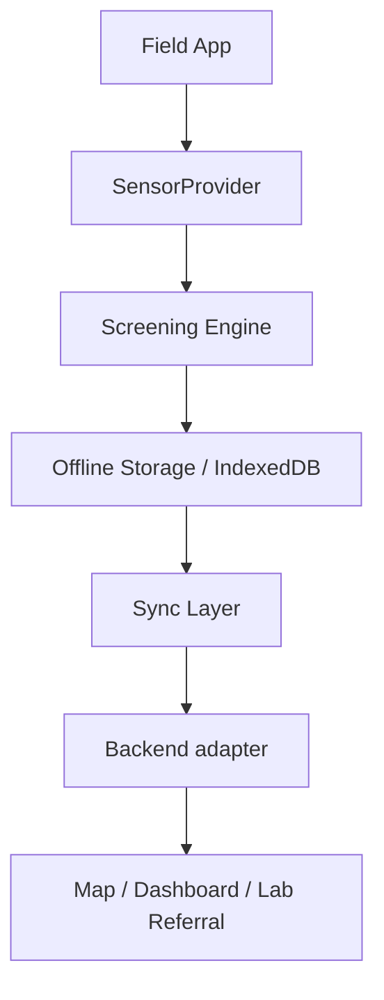

# JalRakshak

Offline-first community water-quality screening and early-warning software for Jharkhand, India. JalRakshak helps a field worker register a water source, simulate a multi-parameter sensor reading, apply transparent screening rules, save the visit without connectivity, and escalate an observation for accredited laboratory confirmation.

> **Scientific disclaimer:** JalRakshak provides preliminary screening only. It is not a laboratory certification and does not determine whether water is safe or unsafe to drink. The thresholds in this software MVP are provisional demonstration values and require validation by qualified experts against the applicable BIS/JJM protocols before any field deployment.

## Problem being solved

Community monitoring is often performed where connectivity is unreliable and specialist equipment is scarce. JalRakshak turns a field observation into a traceable digital record while carefully separating **screening signals** from confirmed laboratory findings.

## What is implemented

- Mobile-first field home with online/offline and pending-sync state
- Source registration, source codes, manual coordinates, browser geolocation, and optional photo
- Hardware-independent `SensorProvider`, explicit data-origin metadata, and animated deterministic presets
- Isolated, typed screening engine returning `NORMAL_SCREENING`, `RETEST`, or `LAB_REFERRAL`
- IndexedDB storage for sources, tests, readings, referrals, and sync state
- Idempotent sync queue transitions: `LOCAL_ONLY → SYNCING → SYNCED` or `SYNC_FAILED`
- Jharkhand-focused MapLibre map and explicit screening-status legend
- Test history, monitoring dashboard, status filtering, and lab-referral creation
- Centralized English/Hindi translations for the core field journey
- Installable PWA shell with versioned same-origin caching and an offline map fallback
- Demo reset and a judge-friendly referral path that takes under 90 seconds

## What is demo / simulated

- Every reading in this MVP—pH, TDS/conductivity, turbidity, and temperature—is generated by `SimulatedSensorProvider`; the UI labels it **SIMULATED — DEMO DATA**.
- The first proposed hardware prototype will focus on TDS/conductivity and temperature. pH and turbidity remain software-demonstration values until appropriate hardware, calibration, and validation exist.
- Screening rules are deterministic **DEMO / PROVISIONAL** rules. They are screening logic, not regulatory or laboratory standards.
- “Sync” uses a local acknowledgement adapter. It demonstrates queue states and idempotency but does not upload to a production cloud service.
- Map markers represent preliminary screening statuses. They are not official contamination records.

## What is planned, not implemented

ESP32/Bluetooth capture, authenticated Supabase synchronization, validated field protocols, offline map packs, and accredited laboratory-result management are intentionally outside this MVP.

## Architecture



The UI only knows the `SensorProvider` contract. `SimulatedSensorProvider` is active now; a future `BluetoothSensorProvider` can return the same typed measurement envelope while marking its origin as `SENSOR`. Stored tests keep their source ID and timestamp, so repeated screenings already form a history suitable for a future current-reading-versus-baseline feature. Screening thresholds live in one explicitly provisional configuration file. Persistence and sync are similarly separated from the UI.

### Important modules

| Area                             | Location                           |
| -------------------------------- | ---------------------------------- |
| Domain models                    | `src/domain/types.ts`              |
| Provisional rule configuration   | `src/domain/screening-config.ts`   |
| Screening engine                 | `src/domain/screening.ts`          |
| Sensor abstraction and simulator | `src/sensors/provider.ts`          |
| IndexedDB repository             | `src/data/database.ts`             |
| Sync transport/state machine     | `src/data/sync.ts`                 |
| Localization                     | `src/i18n/translations.ts`         |
| Field experience                 | `src/components/JalRakshakApp.tsx` |
| MapLibre view                    | `src/components/MapPanel.tsx`      |
| Future PostgreSQL schema         | `docs/supabase-schema.sql`         |

## Local setup

Requirements: Node.js 20.9+ and npm.

```bash
cp .env.example .env.local
npm install
npm run dev
```

Open [http://localhost:3000](http://localhost:3000).

### Environment variables

| Variable                    | Required | Purpose                                         |
| --------------------------- | -------: | ----------------------------------------------- |
| `NEXT_PUBLIC_SYNC_ENDPOINT` |       No | Reserved endpoint for the cloud sync transport  |
| `NEXT_PUBLIC_DEMO_MODE`     |       No | Makes the removable simulator selector explicit |

No secrets belong in `NEXT_PUBLIC_*` variables. `.env`, credentials, pilot coordinates, and private field data are gitignored.

## Demo instructions

1. Click **Test Water Source**.
2. Keep or edit the prefilled handpump details and use browser location if desired.
3. Continue and select **Lab-referral preset** in the visibly marked Demo Mode control.
4. Start screening and watch the four readings arrive.
5. Review the reason codes and scientific disclaimer, then **Save Test**.
6. Create the lab referral and open the map.
7. Use **Dashboard** to inspect the attention queue and **Tests** to view the referral ID.
8. Toggle **हिंदी** at any point in the field flow.

Use **Reset demo data** on Home before a fresh judge walkthrough.

## Offline behavior

IndexedDB is the source of truth for the MVP. Source registration, measurement, saving, mapping, history, dashboard review, and referral creation continue without a network. Each write receives a UUID and `LOCAL_ONLY`; the sync transport sends only non-synced IDs, marks them `SYNCING`, and atomically applies acknowledgements. A failure changes them to `SYNC_FAILED`, allowing a later retry without generating duplicate IDs.

`DemoSyncTransport` acknowledges records locally so the complete demo has no credential dependency. A visible note prevents this from being mistaken for cloud upload. `docs/supabase-schema.sql` documents a compatible PostgreSQL target. Production work should add authentication, row-level security policies, and a server-side bulk-upsert endpoint before selecting a Supabase transport.

Map tiles require connectivity unless already present in the browser cache. Source records and their list/dashboard representations remain available offline.

## Verification

```bash
npm run lint
npm run typecheck
npm test
npm run build
```

Unit coverage includes rule boundaries and invalid values, all deterministic simulator presets and provenance, source-code formatting, IndexedDB persistence, duplicate-save/referral protection, reset behavior, and sync concurrency/partial acknowledgements.

## Screenshots

Browser-QA screenshots are stored in `docs/screenshots/` after the final verification pass.

## Current limitations

- No real ESP32/Bluetooth transport in this iteration
- No authenticated multi-device backend; cloud sync is a local demo adapter
- PWA caching is deliberately minimal, and map tiles are not packaged for offline use
- Photo capture is stored locally as a small data URL and is not uploaded
- No accredited laboratory result entry/editing yet; the referral lifecycle model is ready for it
- Hindi covers the main field journey and guidance; scientific symbols, units, source codes, and stored reason codes remain unchanged intentionally
- Provisional thresholds must not be used operationally before scientific and governance review

## Roadmap

1. Validate rules, units, calibration, and field SOPs with water-quality specialists.
2. Implement an authenticated Supabase bulk-upsert transport with row-level security.
3. Build the ESP32 BLE provider and calibration/connection health workflow.
4. Add encrypted offline map packs and conflict-aware multi-device sync.
5. Add accredited lab result entry, chain of custody, audit history, and export.
6. Expand translations with a Jharkhand-relevant language after field research.

## Replacing the simulator with ESP32

Implement `SensorProvider.measure(onProgress)` in `BluetoothSensorProvider`, returning the existing measurement envelope with readings, provider name, and `dataOrigin: "SENSOR"`. Validate packet checksums, units, calibration metadata, device identity, and timeout behavior inside the provider. Then select that provider through configuration; no field UI or screening-engine rewrite should be required. `LAB_CONFIRMED` is reserved for a future accredited-laboratory workflow and must never be assigned by a field sensor.
