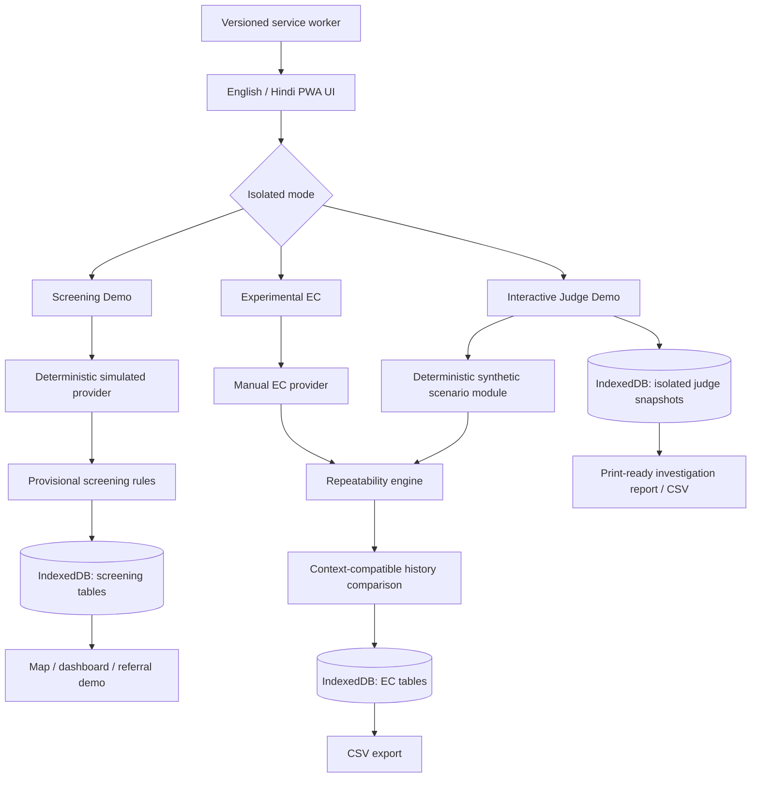

> **Historical archive:** This document describes an earlier revision. Its workflow, deployment notes and test counts are not current. See the [current README](../../../README.md) and [field guide](../../field/daily-work.md).

# Software-only architecture

## Boundaries

- The UI consumes provider contracts; no physical provider is implemented.
- Screening, manual experimental, and synthetic judge records are stored separately.
- History comparison accepts only compatible records with the same explicit origin.
- Map tiles are network-dependent, but local records and fallback lists remain available offline.
- There is no production backend, authentication layer, official integration, or cloud upload.
