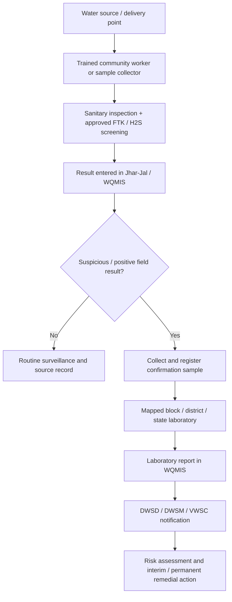

# Existing rural water-quality system

## Finding

India and Jharkhand do **not** lack a community water-quality workflow. JJM already defines community surveillance with FTKs, sanitary inspection, digital capture in WQMIS, a tiered laboratory network, confirmation, official alerts and remedial action. Jharkhand also has Jal Sahiyas and the Jhar-Jal app. JalRakshak must integrate with or complement this ecosystem; a parallel source registry and referral database would duplicate public infrastructure.

## Who does what

| Actor | Existing intended role | Evidence |
|---|---|---|
| Community / trained women | Five people, preferably women such as ASHA/anganwadi/SHG members, are trained to use FTKs and upload results | [JJM WQMS Framework](https://jaljeevanmission.gov.in/sites/default/files/guideline/WQMS-Framework.pdf) |
| Jal Sahiya in Jharkhand | Community mobilization, VWSC participation, FTK/H2S testing, sanitary survey, O&M/service link in documented cases | [JJM Jharkhand case study](https://jaljeevanmission.gov.in/sites/default/files/publication_and_reports/101-glimpses-of-women-power.pdf) |
| VWSC / Gram Panchayat | Village-level planning, surveillance, source/supply oversight and remedial-action participation | [JJM WQMS Framework](https://jaljeevanmission.gov.in/sites/default/files/guideline/WQMS-Framework.pdf) |
| Sample collector | Registers/geotags samples and delivers them to a mapped laboratory | [WQMIS mobile page](https://ejalshakti.gov.in/WQMIS/main/mobile_app) |
| Block/sub-divisional/district/state laboratories | Parameter-specific testing, reporting and quality management; laboratories are intended to be standardized and NABL accredited/recognized | [JJM WQMS Framework](https://jaljeevanmission.gov.in/sites/default/files/guideline/WQMS-Framework.pdf) |
| DWSM / PHED-DWSD officials | Monitor results, arrange confirmation/remedial action and respond to alerts | [WQMIS user guide](https://ejalshakti.gov.in/WQMIS/Home/DownloadUserManualPDF) |
| District health officials | Public-health assessment for repeated/severe contamination alerts | [JJM WQMS Framework](https://jaljeevanmission.gov.in/sites/default/files/guideline/WQMS-Framework.pdf) |
| Public | Locate laboratories, book tests and view information through citizen-facing WQMIS functions | [WQMIS](https://ejalshakti.gov.in/WQMIS/) |

The 2024 Jharkhand assessment says Jharkhand relies on VWSCs, Jal Sahiyas and sample takers; a suspicious result is reconfirmed at NABL-recognized district/state laboratories ([state report, p. 20](https://jaljeevanmission.gov.in/sites/default/files/2025-12/FHTC_Jharkhand_State%20Report.pdf)).

## What is tested and how often

The national framework calls for all village drinking-water sources—including private sources—plus two tail-end delivery points per habitation to be tested with FTKs and sanitary inspection, with results uploaded to WQMIS ([JJM WQMS Framework](https://jaljeevanmission.gov.in/sites/default/files/guideline/WQMS-Framework.pdf)). JJM training material describes a common nine-parameter FTK covering pH, alkalinity, total hardness, chloride, nitrate, fluoride, iron, residual free chlorine and H2S bacteriological screening ([Jal Jeevan Samvad, April 2021](https://master-jalshakti-ddws.digifootprint.gov.in/static/uploads/2024/02/JalJeevanSamvad-April-2021-en-1.pdf)). Actual state-procured kit contents can differ and must be verified locally.

The framework and operational material specify scheduled laboratory and village surveillance, but the exact frequency depends on source, parameter and applicable programme protocol. WHO recommends risk- and stability-based frequency with seasonal timing ([WHO, 2024](https://www.who.int/publications/i/item/9789240088740)). JalRakshak must not invent a universal testing frequency; a pilot should follow the district’s current approved SOP.

## Current workflow

The official framework’s own FTK diagram branches a concerning field result to laboratory testing, and describes alerts to PHED and health officials plus remedial-action tracking ([JJM WQMS Framework, section 9.1](https://jaljeevanmission.gov.in/sites/default/files/guideline/WQMS-Framework.pdf)).

## Existing digital systems

### WQMIS

WQMIS already supports:

- sample/source and location details;
- test date/time and parameters;
- images and sanitary survey;
- FTK, sample collector, laboratory and official roles;
- geotagged registration via mobile app;
- result/report access, lab locator and remedial-action reporting;
- state/district/block/village dashboards and maps in the stated design.

([WQMIS portal](https://ejalshakti.gov.in/WQMIS/), [user guide](https://ejalshakti.gov.in/WQMIS/Home/DownloadUserManualPDF), [mobile app page](https://ejalshakti.gov.in/WQMIS/main/mobile_app)).

### Jhar-Jal

The Jharkhand Space Applications Center’s Jhar-Jal app listing includes geolocated JJM monitoring, handpump surveys, sanitary surveys, discharge measurement and FTK/H2S water testing, and reported 10K+ downloads at access ([Google Play listing](https://play.google.com/store/apps/details?id=com.e.jharkhand_drinking_water_dwsd)). A JJM case study documents a Bokaro Jal Sahiya using Jhar-Jal for grievance reporting and progress monitoring ([JJM case study](https://jaljeevanmission.gov.in/sites/default/files/publication_and_reports/101-glimpses-of-women-power.pdf)).

## What happens after a suspicious field result

The designed path is confirmation testing, notification and remedial action—not a final conclusion from the field kit. WQMIS has specific roles and forms for contaminated FTK samples, laboratory results and interim/permanent remedial action ([WQMIS user guide](https://ejalshakti.gov.in/WQMIS/Home/DownloadUserManualPDF)). Jharkhand’s 2024 state response identifies reconfirmation at district/state NABL-recognized laboratories ([state report](https://jaljeevanmission.gov.in/sites/default/files/2025-12/FHTC_Jharkhand_State%20Report.pdf)).

The missing evidence is execution quality: public documents do not establish Jharkhand’s end-to-end median turnaround, loss-to-follow-up, offline reliability or completeness.

## Implication for JalRakshak

JalRakshak should **not** position itself as:

- the first app to geotag sources or record FTK results;
- a replacement for WQMIS/Jhar-Jal;
- an independent lab-referral authority;
- a new “contamination map.”

Its testable complementary role is:

- capture instrument readings and calibration/quality-control metadata offline;
- make repeated readings for the same source easy and auditable;
- detect non-specific, persistent departures from an established source/season baseline;
- package evidence into the existing approved FTK/sample/laboratory workflow;
- avoid duplicate government records through a future, authorized interoperability/export path.

Whether officials and Jal Sahiyas want this complement is an unresolved field-research question.

