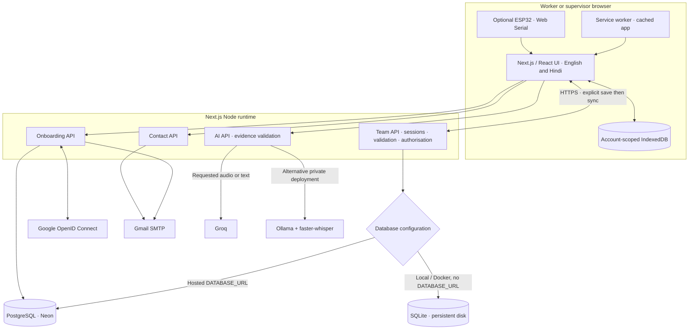
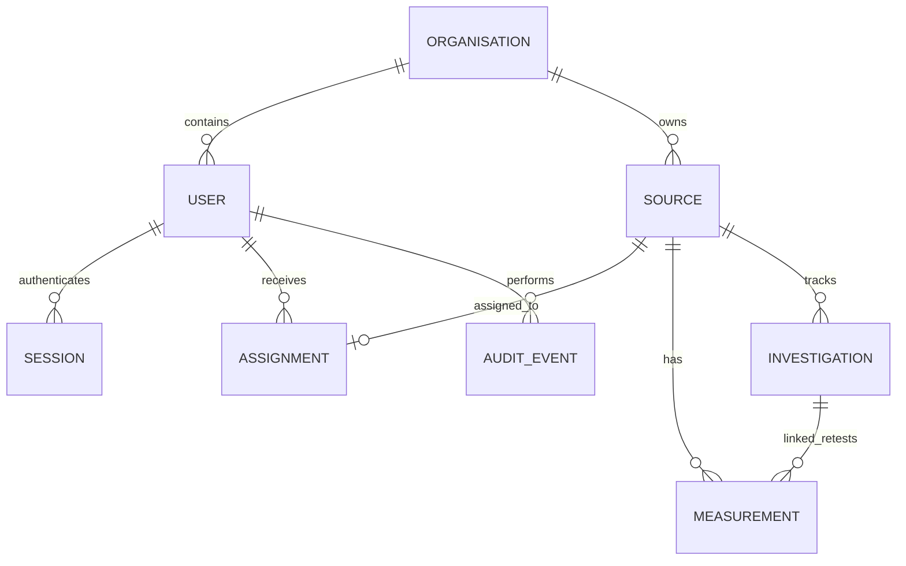

# Technical design

Current software architecture · 27 October 2026

JalRakshak coordinates water-source visits, evidence and follow-up. Workers save
records offline; supervisors review synced evidence within their organisation.
EC comparisons are provisional investigation aids, not contaminant identification
or drinking-water certification.

## 1. System architecture



Deployment choices are alternatives: Vercel uses PostgreSQL; the standard local
and Docker setup uses SQLite. Vercel refuses to fall back to ephemeral SQLite.
Map tiles require a connection; source lists and saved field records remain usable offline.

## 2. Components and responsibilities

| Component | Implementation |
| --- | --- |
| Team UI, login, signup, reports | `src/components/field/` |
| Field models, rules, import, reports and validation | `src/field/`, `src/ec/` |
| Offline storage and account databases | `src/data/database.ts`, `src/team/client.ts` |
| Authenticated sync and team management | `src/app/api/team/[...path]/route.ts` |
| Database adapters | `src/team/store.ts`, `server.ts`, `postgres.ts` |
| Organisation signup and invitations | `src/team/onboarding.ts`, `google.ts`, onboarding route |
| AI transcription and reviewed drafts | `src/ai/`, `src/app/api/ai/[action]/route.ts` |
| ESP32 stream validation and monitor | `src/sensors/` |
| PostgreSQL schema | `deploy/postgres/001-team.sql` through `003-organisations.sql` |

## 3. Data model and isolation



This is a **logical model**, not a literal table diagram. Sources, measurements
and investigations are JSON bodies in the shared `records` table. Schedules and
visit reviews are stored on sources; visit photos and capture evidence are part of
measurement bodies. The server also stores users, sessions, assignments, audit
events, rate-limit state and temporary sync uploads. Hosted onboarding adds
organisations and hashed, expiring verification/invitation tokens.

PostgreSQL scopes records, assignments and management operations by organisation.
Workers receive their assigned source set; supervisors manage their own organisation.
Authorisation is enforced in server operations and SQL queries, not by hiding UI
controls. This is application-enforced isolation; the design does not claim database
row-level security policies. SQLite supports a single private team.

The browser keeps account-scoped IndexedDB data and draft keys. Training and legacy
records have separate scopes/storage paths and do not become real field evidence.

## 4. Visit, sync and review

```mermaid
sequenceDiagram
  participant W as Worker
  participant D as Device storage
  participant A as Team API
  participant DB as Shared database
  participant S as Supervisor
  W->>D: Select source, record readings, photos and notes
  W->>D: Check repeatability, then save visit
  Note over W,D: Offline work stays on this device until sync succeeds
  D->>A: Sync saved records and expected revision
  A->>A: Check session, assignment, scope and evidence
  A->>DB: Transactional revision check and write
  alt Current revision or identical retry
    DB-->>A: Committed snapshot
    A-->>D: Confirm sync and refresh allowed records
  else Conflicting revision
    A-->>D: Conflict; retain local recovery copy
    W->>D: Review differences before resolving
  end
  S->>A: Load organisation evidence
  S->>A: Review, request correction or linked retest
  W->>A: Sync to receive follow-up
```

Saved records upload while the app is open and online. Unsaved forms are not synced.
Stale revisions reject the submission rather than overwriting concurrent work;
identical lost-response retries are idempotent. Existing saved measurement
snapshots and investigation events cannot be silently rewritten. Corrections and
linked retests preserve evidence history.

Large photo-bearing sync payloads can use session-bound staging chunks. Incomplete
uploads are not applied; the total sync limit remains 50 MB. The monthly report uses
records currently available on the device, so supervisors should sync before reporting.
Server overview and AI summaries are based on authorised shared records.

## 5. Identity, security and external services

- Passwords use salted scrypt hashes. Server session tokens are random and stored
  as hashes; cookies are HttpOnly, SameSite Strict and Secure on HTTPS. Sessions last 12 hours.
- Mutating requests check the configured origin. Server-side validators reject
  unauthorised source access and malformed or altered evidence.
- Public signup requires PostgreSQL, an HTTPS origin and an explicit enable flag.
  Email verification creates a supervisor and organisation; invitations fix the
  recipient to a worker role and the inviter's organisation.
- Google login uses PKCE, browser-bound state, nonce and signed ID-token validation.
  Google access/refresh tokens are not retained, and matching emails do not silently
  link Google to existing password accounts.
- Gmail sends onboarding and contact messages. Contact submissions are not kept in
  a separate application database; email copies remain in mailboxes.
- AI runs only on request. Groq receives requested audio for transcription or selected
  text for drafting; private Ollama/Whisper services are an alternative. Photos are
  not uploaded to Groq; selected captions may be included. Outputs are validated and
  reviewed before saving. AI cannot approve visits or change measured values.
- Groq failures or quota limits leave manual workflows available. AI limits are
  per server process, not a global serverless quota.

## 6. Offline access, recovery and operational limits

Cached offline access lasts up to 12 hours after an online sign-in. Server revocation
takes effect on the next server request; it cannot remotely erase an offline device.
Browser storage is not encrypted at rest. Use trusted devices and separate profiles.

Field backups include saved sources, photos, measurements and investigation history,
but exclude accounts, drafts, training and legacy records. Downloads can use password
encryption. Restore previews additions and does not overwrite existing records.
SQLite server backups include synced accounts and team data; keep them private and
copy them off-device. Hosted PostgreSQL needs its own export/restore procedure:
the SQLite scheduler does not run on Vercel. Hosted backup health is unverified
until an operator verifies the recovery arrangements.

ESP32 USB capture accepts compatible serial packets, checks freshness and independent
capture evidence, and requires review/save. The simulator produces isolated synthetic
readings. Software checks do not establish physical sensor accuracy.

## 7. Deployment and validation

GitHub Actions runs lint, TypeScript, unit/database tests, production build,
sandboxed Playwright release tests, and isolated Docker HTTPS/AI recovery checks.
PostgreSQL tests use a disposable local test database; provider calls are mocked in
contract tests. Automated tests do not establish field accuracy or guarantee live
Google, Gmail or Groq configuration.

See [setup and environment](deployment/environment.md), [test cases and sample data](testing.md),
[Vercel](deployment/vercel.md), [Docker](deployment/docker.md), and [recovery](deployment/team-local.md).
Earlier architecture documents under `docs/archive/` are historical only.
